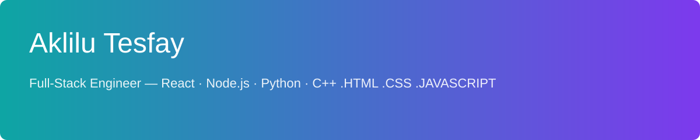
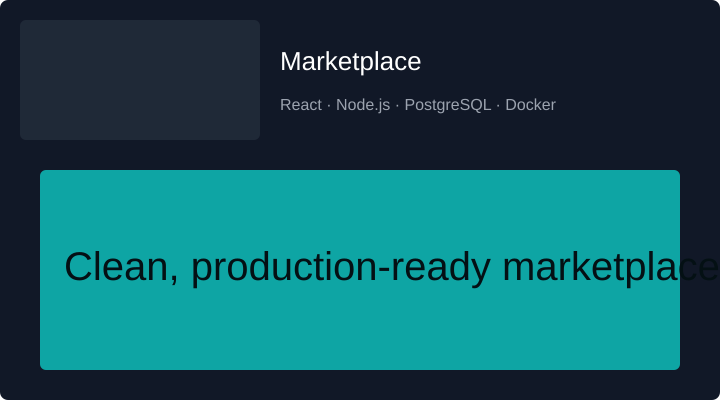
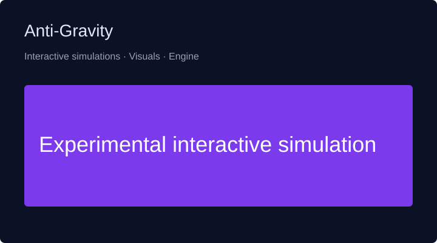

# Hi, I’m Aklilu Tesfay 👋

  

  <strong>Full‑Stack Engineer</strong> — building real products people use.

  Node.js · Python · PHP · React.js · JavaScript · Java · C++ · HTML · CSS

  
  
  

---

## 🚀 About
I’m Aklilu (Aklilu Tesfay) — I turn product ideas into robust, maintainable full‑stack apps: marketplaces, APIs, and interactive experiences. I focus on shipping clean frontend UX and solid backend systems.

---

## 🔥 Portfolio — Showcase

**Marketplace**  
A scalable marketplace connecting buyers & sellers with a clean UX, payments integration, and admin tools.  
Tech: React · Node.js · PostgreSQL · Docker  
[View repo »](https://github.com/aklilut40-code/marketplace)

---

**Anti‑Gravity (experimental)**  
An interactive/experimental project demonstrating simulation, visuals, and creative engineering.  
Tech: JavaScript · React · Python · C++  
[View repo »](https://github.com/aklilut40-code/anti-gravity)

---

## 🛠️ Tech Stack

  &nbsp;
  &nbsp;
  &nbsp;
  &nbsp;
  

- Frontend: React.js, JavaScript (ES6+), HTML5, CSS3
- Backend: Node.js, Python, PHP, REST & GraphQL APIs
- Languages: Java, Advanced Java, C++, JavaScript
- Dev tools: Docker, CI/CD, testing, performance tuning

---

## 📊 GitHub at-a-glance

---

## 💡 What I build
- Marketplace & e‑commerce platforms
- Backend systems and APIs
- Interactive web apps and simulations

---

## 📫 Contact
- GitHub: https://github.com/aklilut40-code
- Email: aklilu.tesfay@gmail.com

---

Thanks for stopping by — I build, I ship, I iterate. 🚀

